# v3 + bge-m3 결정 헤드 — 학습·추론 파이프라인

`configs/bge_v3.yaml` → `models/head_dynamic_bge_v3.pt` 가 만들어지고, 그
체크포인트가 `/api/decide-dynamic` 에 답하는 과정. 근거 코드:
`head/dynamic_model.py`(`_forward_film_set`, `save_dynamic_head`),
`head/dynamic_train.py`(`train_dynamic_head`), `cli.py`(`cmd_extract`,
`cmd_train_dynamic`), `webapp/agents.py`(`_state_tensor`).

핵심은 **bge-m3가 양쪽에서 동결**이라는 점이다. 학습은 인코더로 역전파하지
않고 임베딩만 뽑아 캐시한다. 실제로 학습되는 것은 ~430K 파라미터 헤드뿐이다.

## 1. 전체 흐름

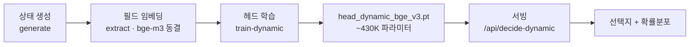

- 파란 단계(`extract`, 그리고 서빙 시 임베딩)만 bge-m3를 쓴다. 그래디언트는
  흐르지 않는다.
- `extract` 가 별도 단계인 이유가 여기 있다. 임베딩을 한 번 만들어 `.npz` 로
  캐시해 두고, 학습은 그 위에서만 돈다.

## 2. 데이터 생성

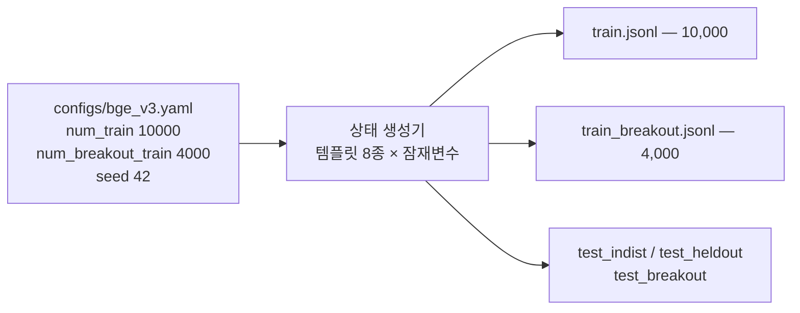

| split | 개수 | 비고 |
|---|---|---|
| `train` | 10,000 | 문서 상태 |
| `train_breakout` | 4,000 | 기하로부터 gold 역산 |
| `test_indist` | 1,000 | 같은 템플릿 |
| `test_heldout` | 1,000 | `report`, `config_file` — 학습에 없음 |
| `test_breakout` | 500 | |

각 상태는 `{doc_id, state_type, text, labels, fields}` 이다. `fields` 는
breakout 에만 있고, 렌더러가 같은 잠재변수에서 방출하므로 text 와 어긋날 수 없다.

> 이 config 는 **랜덤 합성 뱅크**를 쓴다. `systematic: true`(전수 그리드)는
> `bge_grid_v3.yaml` / `bge_typed_v3.yaml` 이다. `docs/grid-dataset.md` 참조.

## 3. 필드 임베딩 추출

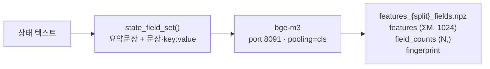

상태를 **필드 집합**으로 쪼개 각각 임베딩한다. 상태 *i* 는 `[offset_i :
offset_i + M_i]` 행을 소유한다 — 하나의 패딩 텐서로 만들지 않는다.

측정값: **10,000 상태 → 65,815 필드 벡터** (상태당 평균 6.6개).

`fingerprint` 는 백본 신원(모델 + pooling + ctx + dim)의 해시다. 다른 백본의
임베딩이 조용히 재사용되는 것을 막는다.

## 4. 헤드 학습

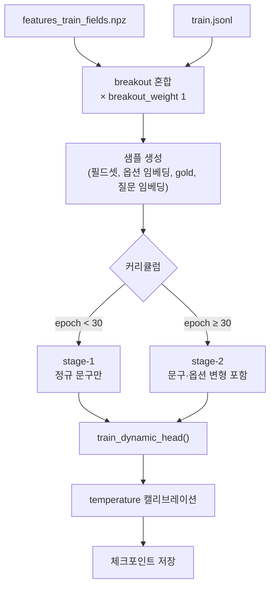

- **3-way 분할** (seed 42): calibration 10% / train 80% / val 20%
- **anchor 30 에폭**: 정규 문구만 학습해 기준선을 만든 뒤 변형을 넣는다.
  처음부터 변형을 주면 헤드가 불안정해진다.
- val_acc 개선 없으면 **patience 20** 에서 조기 종료
- 헤드: `DynamicDecisionHead(film=True, arch_version=3)`, hidden 256,
  d_k 128, lr 1e-3, batch 128

### 체크포인트 구조

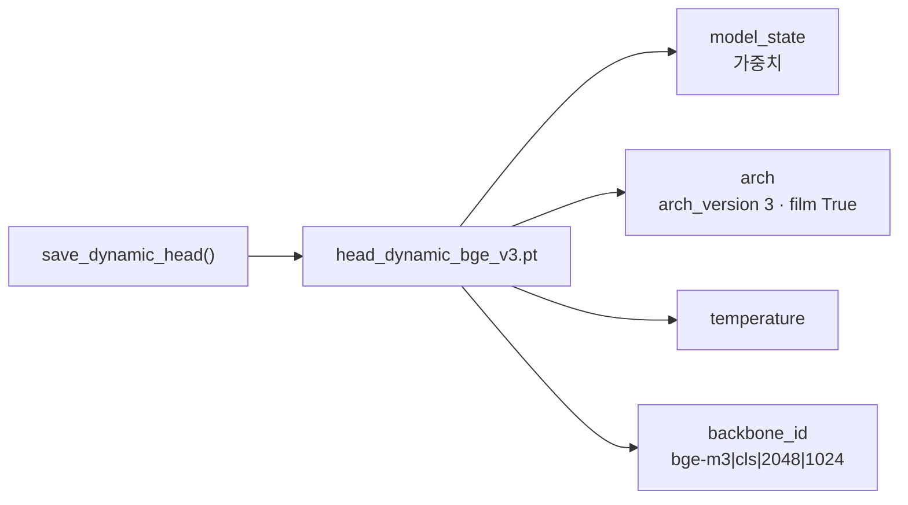

**`arch_version: 3` 이 로드 시 FiLM 경로를 결정한다** — config 의 `film`
플래그가 아니다. 그 플래그는 학습할 때만 읽힌다. (확인: config 에
`film: false` 여도 v3 체크포인트는 `q_mod_scale`/`z_mod_scale` 을 가진 채로
로드된다.)

`backbone_id` 가 학습 백본과 다르면 로드 시 경고한다. 다른 백본으로 서빙하면
같은 형태·다른 공간이라 그럴듯한 오답이 나오기 때문이다.

## 5. 추론

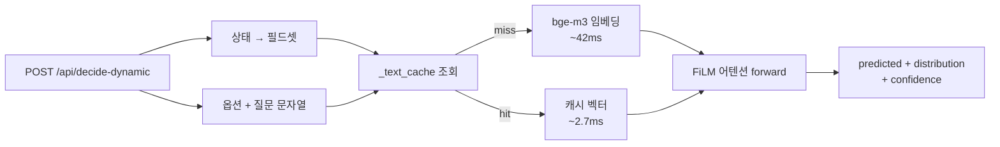

캐시는 프로세스 수명 동안 유지된다. 같은 상태가 다시 오면 42ms → 2.7ms 다.
벤치마크에서 **첫 arm 이 느린 이유**가 이것이다 — 네 arm 이 같은 seed 에서
출발하므로 초반 상태가 동일하다.

### v3 순전파 (FiLM)

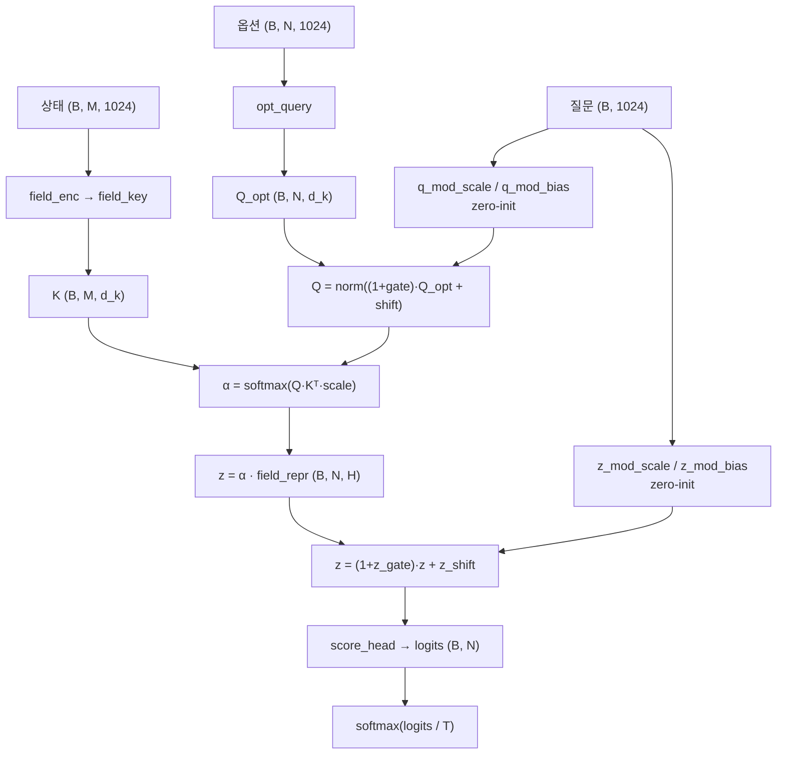

네 개의 변조 선형층이 전부 **zero-init** 이다. 학습 0스텝에서 헤드는 정확히
v2 와 같고, 질문 조건화를 학습으로 얻는다.

## 6. 온톨로지 계층 — 추론 시 헤드 앞뒤에 붙는 구조

`laya-example` 의 breakout 데모는 헤드를 그냥 부르지 않는다. **모델을 부를지
말지 결정하고, 무엇을 물을지 문구를 바꾸는** 계층이 앞뒤에 있다. 근거 코드:
`static/breakout_ontology.js`(TBox·ABox·reason·canCatch),
`static/ontology_core.js`(도메인 비의존부), `static/breakout_panel.js`(shouldAsk),
`static/breakout.html`(프레임 루프).

### 6.1 전체 위치

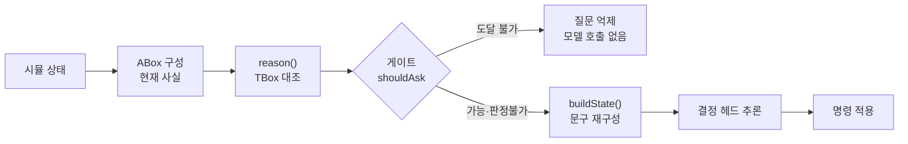

게이트가 `true` 를 내는 두 경우가 핵심이다 — "잡을 수 있다"와 "판정 자체가
없다". **확실히 도달 불가일 때만** 억제한다. 한 방향 보장이다.

### 6.2 TBox — 선언된 공리

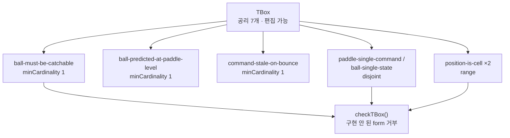

공리는 **제어 흐름이 아니라 선언**이다. 값(도달 가능성, 착지점)은 물리
rollout 에서 **주입**된다 — 공리는 "그 답이 존재한다"를 선언할 뿐 계산법을
정하지 않는다. 착지점을 두 번 구현하면 틀릴 곳이 두 곳이 되기 때문이다.

`checkTBox` 는 **아무것도 구현하지 않는 form 의 공리를 거부**한다. 선언됐지만
평가되지 않는 공리는 강제되는 것처럼 읽히면서 실제로는 무동작이기 때문이다.

### 6.3 ABox — 매 틱 구성되는 사실

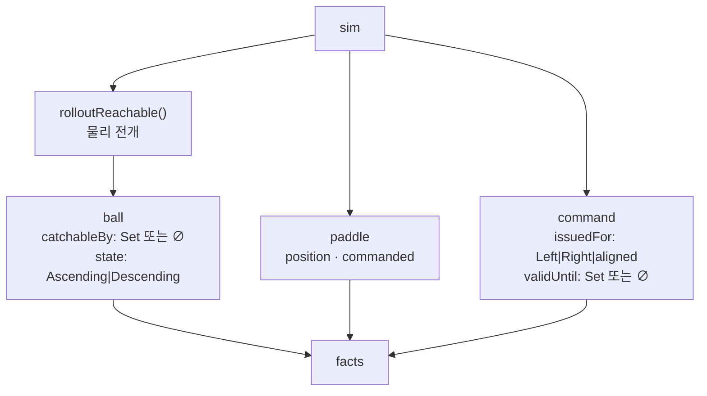

**빈 집합이 곧 위반이다** (`∅` not absent). 폐쇄 세계 가정에서 집합이 비었다는
것 자체가 주장이고, 사실이 빠진 것과 다르다. `catchableBy` 가 비면 도달 불가,
`validUntil` 이 비면 명령이 무효다.

`command` 개체는 **발행된 명령이 있을 때만** 존재한다. 명령이 없는 상태는
stale 과 다른 상태이고, stale 로 보고되면 안 된다.

### 6.4 reason() — TBox 대조

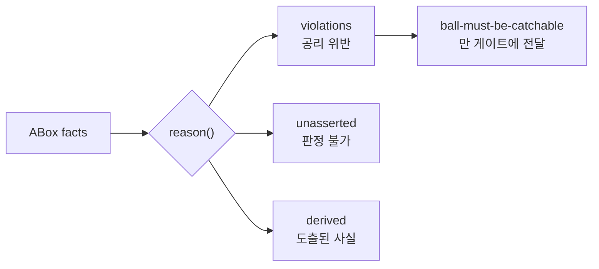

`reason()` 은 **순수 함수**다 — ABox 만의 함수이고 sim 을 다시 읽지 않는다.
`nowSide` 같은 값도 ABox 구성 시점에 계산해 넣는다.

### 6.5 게이트 판정

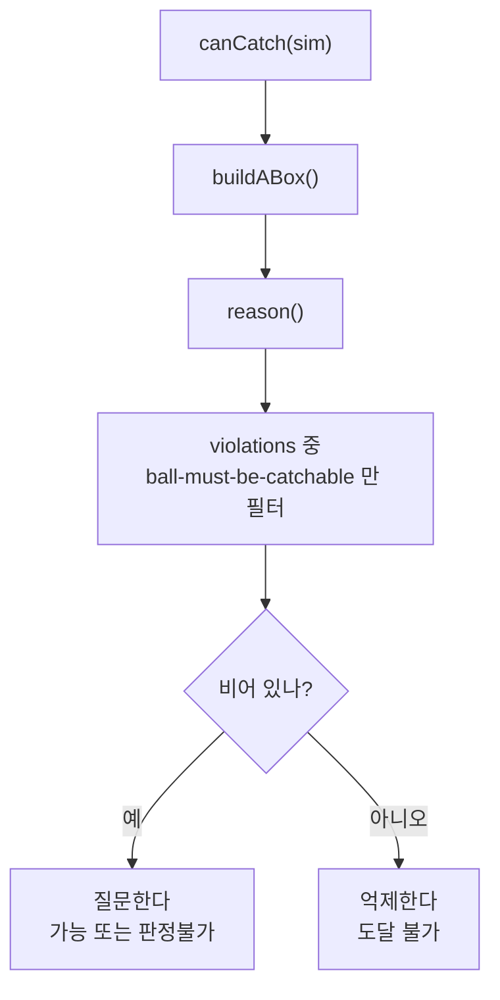

범위·배타 공리는 **게이트하지 않는다**. 그건 시뮬레이터가 항상 만족하는
사실이라, 발화하면 버그이지 질문을 멈출 이유가 아니다.

### 6.6 stale 명령 축 — 두 번째 행동 변경

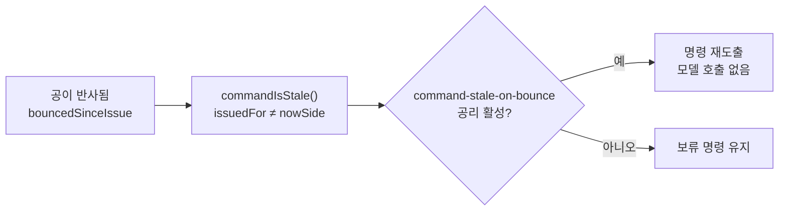

이 공리만 위반이 **행동 가능**하다. 도달 불가 위반은 "물리가 그랬다"로
면제되지만, stale 은 재도출이 옳고 **모델 호출이 들지 않는다**(좌표 비교는
반사에 연속이라 아무것도 탐지하지 못한다 — 그래서 **좌표가 아니라 면**으로
선언된다).

### 6.7 전제와의 관계

앞 부록의 네 가지 전제는 **모델 쪽 제약**이고, 이 장은 **그 앞뒤의 결정
계층**이다. 둘은 직교한다:

| | 결정 | 위반 시 |
|---|---|---|
| 온톨로지 (이 장) | 질문할지, 문구를 어떻게 줄지 | 질문이 억제되거나 명령이 보류됨 (관측 가능) |
| 헤드 전제 (부록) | 문구를 어떻게 쓸지 | API 는 정상, **답만 조용히 틀림** |

온톨로지는 **소리 나게** 실패한다 — 패널에 "판정 불가"라 쓰거나 질문을
건너뛴다. 헤드 전제는 조용히 실패한다. 그래서 전자만 문서화해도 부족하고,
둘 다 필요하다.

## 7. v3 vs v4

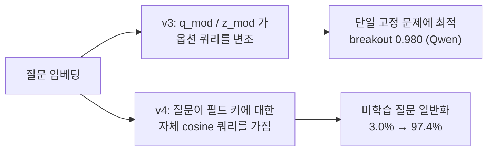

| | v3 (FiLM) | v4 (question-field attention) |
|---|---|---|
| 질문의 역할 | 옵션 쿼리를 변조 | 필드셋을 직접 조회 |
| 파라미터 | `q_mod` / `z_mod` (dense) | 자체 어텐션 쿼리 + `qz_readout` |
| 강점 | 단일 고정 문제 | 처음 보는 질문 |
| bge 에서 | 두 방식이 소수점 셋째 자리까지 동일 | |

v3 는 소수 문구에 dense 맵을 규제하므로 **미학습 질문**에 약하고(그걸 v4 가
고친다), **단일 고정 문제**에는 강하다. bge 에서 둘은 소수점 셋째 자리까지
동일하다 — `docs/v3-bge-single-problem.md` 의 0.980 은 v3+Qwen 수치다.

## 8. 비용

| 단계 | 시간 |
|---|---|
| `generate` | 수 초 |
| `extract` | ~60분 (랜덤 뱅크) / ~5분 (그리드) |
| `train-dynamic` | ~70분 (랜덤 뱅크) / ~4분 (그리드) |
| 추론 (콜드) | ~42ms |
| 추론 (캐시 히트) | ~2.7ms |

## 9. 동결 vs 학습

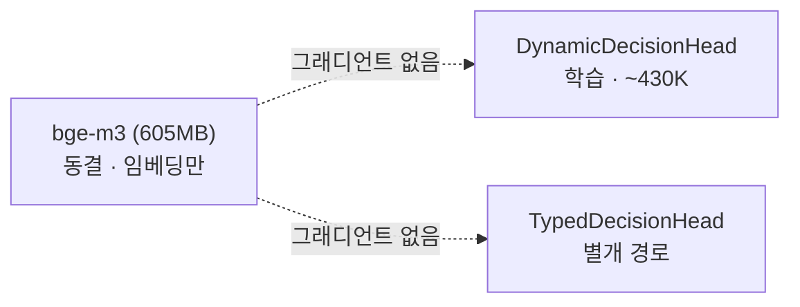

## 부록: 서빙 시 지켜야 할 전제

헤드는 관측 문구에 대해 특정 가정을 한다. 어기면 API 는 정상 응답하지만 답만
조용히 틀린다.

| 전제 | 내용 |
|---|---|
| 중심 대역 | `\|gap\| ≤ 24` 를 "중심"으로 학습. 20px 를 "clearly to the RIGHT" 로 쓰면 오답 |
| 중심 문구 | 중심은 `drifting left, falling` + `The paddle is under the ball` (side 경로와 다름) |
| 절대 좌표 | `x≈480` 같은 좌표는 학습 데이터에 **0회**. `gap N px` 서술만 존재 |
| 문장 분리 | `Falling toward the paddle.` 는 자체 문장. 기하 문장에 병합하면 필드가 오염된다 |

laya-example 의 `buildState` 가 이 네 가지를 어겨 breakout 답이 붕괴한 사례가
있고, 수정 이력은 그 저장소의 `fix-breakout-state-prose` 브랜치에 있다.
